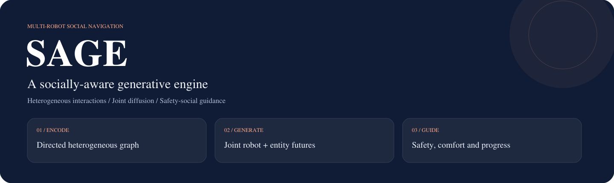
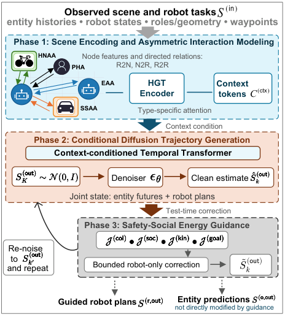

<p align="center"></p>

<h3 align="center">A Socially-Aware Generative Engine for Heterogeneous Multi-Agent Navigation</h3>

<p align="center">
  <a href="docs/installation.md">Installation</a> ·
  <a href="docs/reproduction.md">Reproduction</a> ·
  <a href="results/README.md">Results</a> ·
  <a href="https://arxiv.org/abs/2607.16619">Paper (arXiv)</a> ·
  <a href="README.zh-CN.md">中文</a>
</p>

**SAGE jointly generates robot plans and surrounding-agent futures, then refines robot motion with safety and social guidance.** A directed heterogeneous graph captures agent roles and asymmetric interactions; a conditional diffusion model models joint motion; differentiable guidance adds collision avoidance, comfort, kinematics and task progress during sampling.

## Method

<p align="center"></p>

| Component | Implementation | Purpose |
| --- | --- | --- |
| Heterogeneous interaction encoder | [`sage/models/`](sage/models) | Encode roles, geometry and directed relations |
| Joint trajectory diffusion | [`sage/models/sage_model.py`](sage/models/sage_model.py) | Generate robot and entity futures together |
| Safety-social guidance | [`sage/guidance/`](sage/guidance) | Refine robot plans during inference without retraining |
| Scene adapters and metrics | [`sage/data/`](sage/data) · [`sage/evaluation/`](sage/evaluation) | Connect datasets, batching and evaluation |

## Quick start

Use a dedicated Python environment; Python 3.9 is the original SAGE environment target. Follow [installation](docs/installation.md), then run from this repository root:

```bash
python -m sage.experiments.smoke_test --device cpu --stride 10
```

This data-free example runs forward and backward passes and guided trajectory generation. A successful run prints a finite loss and diagnostics. It checks the implementation; paper experiments require their datasets, configurations and trained checkpoints.

For an end-to-end synthetic training example:

```bash
python -m sage.experiments.train_sage --device cpu --epochs 1 --save experiments/example/sage.pt
```

## Experiments and evidence

The manuscript evaluates ETH/UCY, Stanford Drone Dataset and controlled synthetic navigation, including guidance trade-offs, ablations and robot-count scaling. The [44 retained CSVs](results/README.md) preserve the selected numerical records and important model-selection evidence.

ETH/UCY uses pedestrian trajectories with a target-as-robot proxy and speed-derived role labels. This adapter evaluates controlled navigation and pseudo-heterogeneity; SDD semantic labels and synthetic settings provide different evidence. See the [reproduction guide](docs/reproduction.md) for the protocol and interpretation of each result group.

| Start here | Contents |
| --- | --- |
| [Reproduction](docs/reproduction.md) | Data checks, training, evaluation and result interpretation |
| [Selected results](results/README.md) | Benchmarks, ablations, guidance, scaling and selection records |
| [Assets](docs/assets.md) | Dataset sources and 30 retained checkpoint checksums |
| [Paper on arXiv](https://arxiv.org/abs/2607.16619) | Public preprint and version history |

## Repository layout

```text
sage/          SAGE models, guidance, adapters and experiment entry points
configs/       Research configurations
scripts/       Convenience wrappers for training and evaluation
results/       Selected numerical results
docs/          Installation, reproduction and asset guides
provenance/    File origins and artifact checksums
```

The top-level `models/`, `dataset/`, `environment/`, `evaluation/` and `utils/` retain MID/Trajectron++ compatibility code. Large inputs and weights are distributed separately from source control; current availability is explicit in [assets](docs/assets.md).

## Citation and acknowledgments

Use [CITATION.cff](CITATION.cff) or [the BibTeX entry](docs/citation.bib). The associated preprint is available as [arXiv:2607.16619](https://arxiv.org/abs/2607.16619).

The baseline and data compatibility code builds on [MID](https://github.com/Gutianpei/MID) and Trajectron++. Preserve their attribution when using those modules. See [third-party notices](THIRD_PARTY_NOTICES.md) and [license status](LICENSE).

[Contributing](CONTRIBUTING.md) · [Changelog](CHANGELOG.md) · [TRACER companion project](https://github.com/Larryhul/TRACER)
