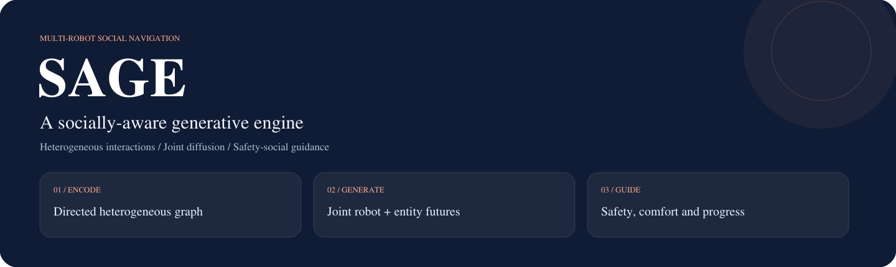
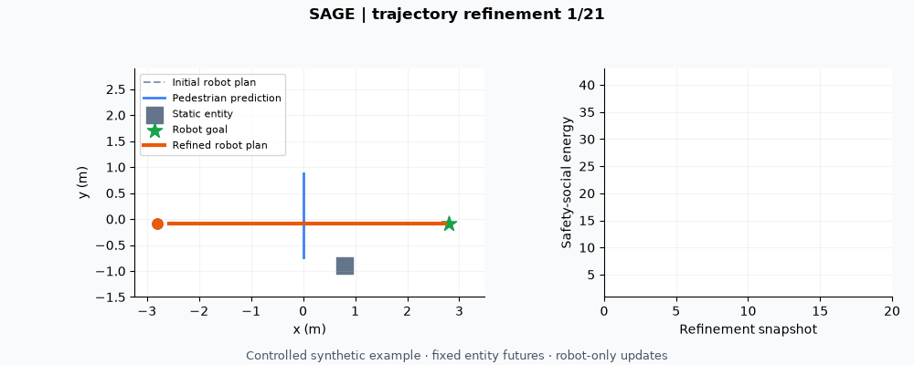
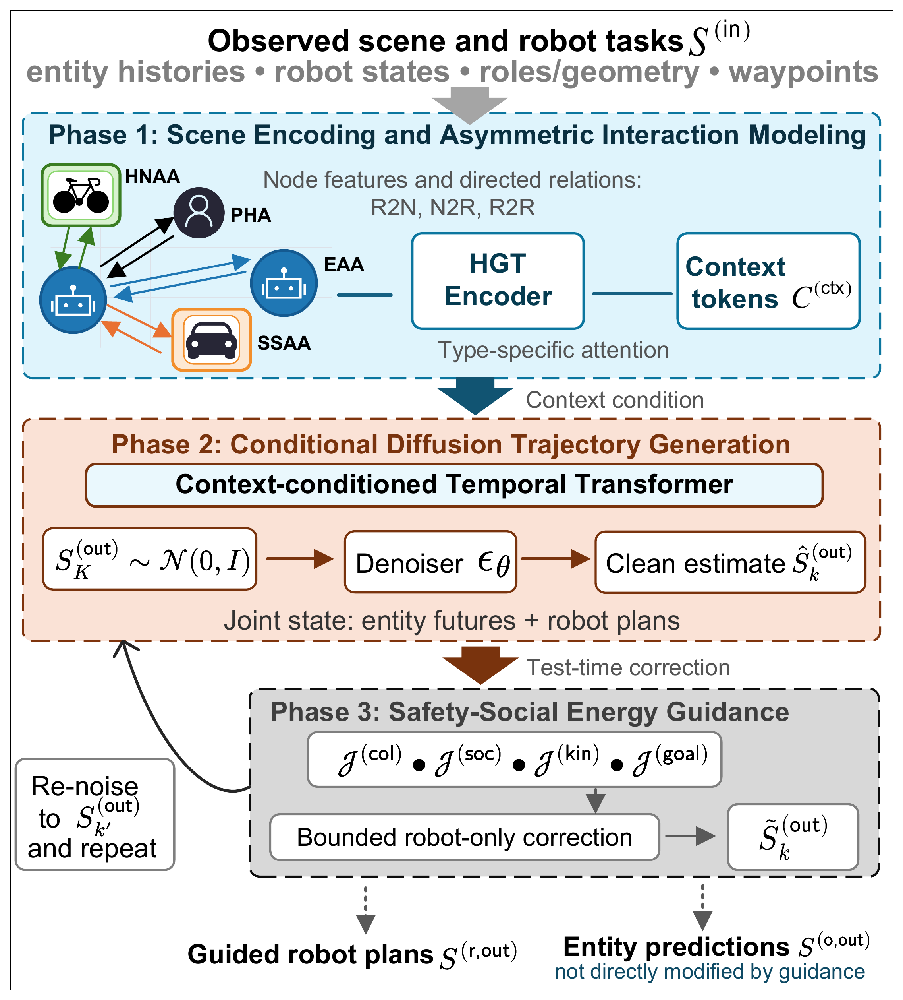
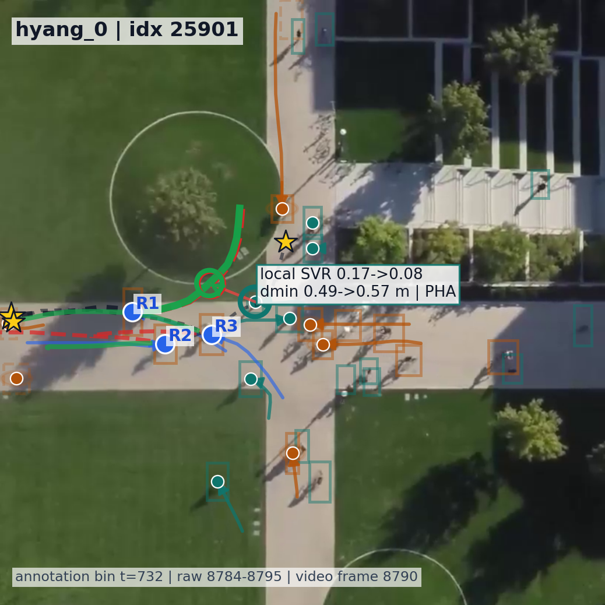

<p align="center"></p>

<h3 align="center">A Socially-Aware Generative Engine for Heterogeneous Multi-Agent Navigation</h3>

<p align="center">
  <a href="https://github.com/Larryhul/SAGE/actions/workflows/cpu-checks.yml"></a>
  <a href="https://arxiv.org/abs/2607.16619"></a>
  <a href="LICENSE"></a>
  <a href="https://colab.research.google.com/github/Larryhul/SAGE/blob/main/notebooks/quickstart.ipynb"></a>
</p>

<p align="center"><a href="#quick-start">Quick start</a> · <a href="docs/reproduction.md">Experiments</a> · <a href="docs/models.md">Models</a> · <a href="results/README.md">Results</a> · <a href="https://arxiv.org/abs/2607.16619">Paper</a> · <a href="README.zh-CN.md">中文</a></p>

**SAGE jointly generates robot plans and surrounding-agent trajectories, then refines robot motion with safety and social guidance.**

- **Encode heterogeneous interactions:** directed, role-aware graph representations.
- **Generate joint futures:** conditional diffusion for robot plans and entity trajectories.
- **Refine robot motion:** differentiable safety, social, kinematic and goal guidance at inference.

## Quick start

Use Python 3.12 and follow the [installation guide](docs/installation.md) to create an environment. From this repository:

```bash
python -m pip install -e ".[dev]"
python -m sage.demo --output outputs/demo
```

The CPU example refines a crossing-scene robot trajectory while keeping entity predictions fixed. It writes an animation, a final plot and an energy trace.



See [the demo guide](docs/demo.md) for inputs, outputs and interpretation.

## Method

<p align="center"></p>

## Experiments and results

| Setting | Retained results |
| --- | --- |
| ETH/UCY | Prediction, guidance and ablation records using a target-as-robot proxy |
| Stanford Drone Dataset | Navigation results using semantic annotations |
| Synthetic navigation | Guidance trade-offs and robot-count scaling |

The [result index](results/README.md) identifies the protocols and status of 44 retained CSV files. Commands and required inputs are in the [experiment guide](docs/reproduction.md).

## Qualitative example

<p align="center"></p>

Three robots (R1–R3) navigating a Stanford Drone Dataset crossing (`hyang_0`). Entity predictions are shown with the robot plans before and after guidance; see the paper for the legend. Scene imagery belongs to the Stanford Drone Dataset and follows its terms.

## Models

Six original goal-conditioned research checkpoints are available for ETH/UCY and SDD.

```bash
python tools/download_models.py
```

Downloads are verified against the release checksum. See [model details](docs/models.md) for checkpoint identity and use.

## Development

```bash
python tools/check_repository.py
python -m pytest -q
```

CPU checks run on Linux and Windows. Tests requiring archived experiment outputs or CUDA report their prerequisites through explicit skips. See [verification](docs/verification.md).

## Repository layout

```text
sage/          Models, guidance, data adapters and experiment modules
configs/       Dataset and ablation configurations
results/       Selected numerical records
docs/          Setup, examples and experiment guides
provenance/    File origins and checksums
```

## Citation

Please cite the [paper](https://arxiv.org/abs/2607.16619) when using SAGE in research. [BibTeX](docs/citation.bib) · [CITATION.cff](CITATION.cff).

```bibtex
@misc{sage_manuscript,
  title = {SAGE: A Socially-Aware Generative Engine for Heterogeneous Multi-Agent Navigation},
  author = {Hu, Lan and Liwang, Minghui and Zhu, Wenbo and Yi, Xinlei and Hong, Yiguang and Wang, Xianbin and Jiao, Zhenzhen and Hosseinalipour, Seyyedali},
  year = {2026},
  eprint = {2607.16619},
  archivePrefix = {arXiv},
  primaryClass = {cs.RO},
  url = {https://arxiv.org/abs/2607.16619}
}
```
